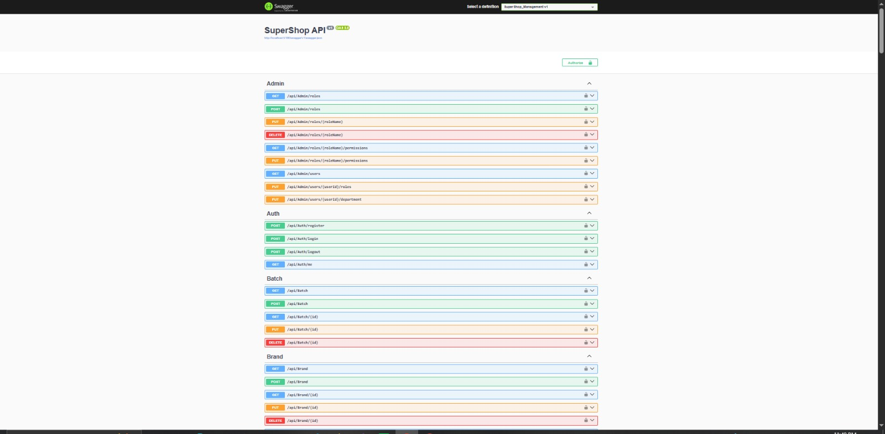
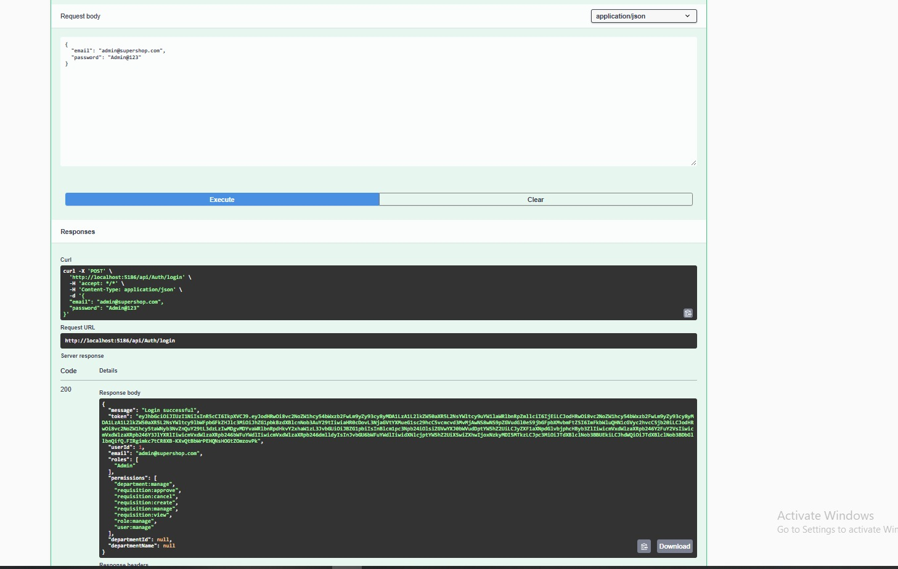
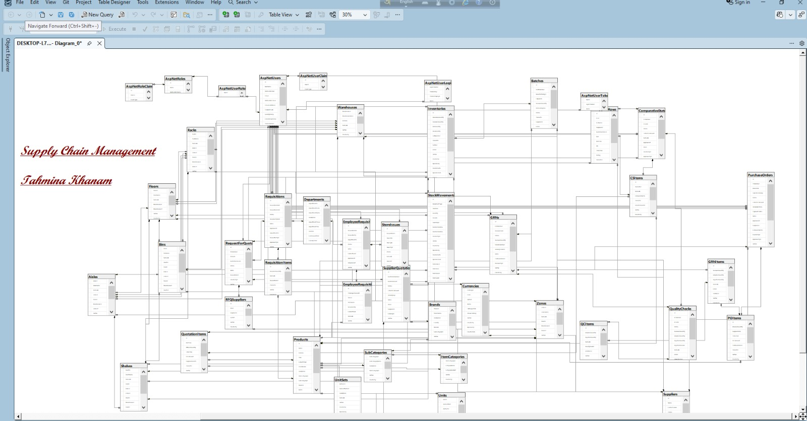

<h1 align="center">🏭 SupplyChain ERP Core API</h1>

<p align="center">
  <b>A powerful REST API for end-to-end Supply Chain & Inventory Management</b><br/>
  Built with ASP.NET Core 8 · SQL Server · JWT Auth
</p>

<p align="center">
  
  
  
  
  
  
</p>

---

## 📖 About

A complete Supply Chain ERP backend that automates the full procurement-to-receipt cycle — from employee requisition to GRN approval — with bin-level inventory tracking and role-based authorization.

## ✨ Features

- 🔐 **JWT Authentication** — role & permission-based authorization
- 🔄 **Multi-Level Approval** — Requisition → Store → Purchase → RFQ → CS → PO → GRN → QC
- 🏭 **Bin-Level Inventory** — 7-level warehouse location chain
- ⏱️ **FIFO Stock Deduction** — by batch expiry priority
- 💱 **Multi-Currency Support** — auto BDT conversion
- 📦 **Batch & Expiry Tracking**
- 📊 **Stock Movement Audit Trail**
- 🌱 **Auto Seed Data** — 10 roles + admin + master data

---

## 🚀 Quick Start

### 1️⃣ Clone

```bash
git clone https://github.com/TahminaKhanNipa10-Codes/SupplyChain-ERP-CoreAPI.git
cd SupplyChain-ERP-CoreAPI
```

### 2️⃣ Restore Packages

```bash
dotnet restore
```

### 3️⃣ Configure `appsettings.json`

```json
{
  "ConnectionStrings": {
    "DefaultConnection": "Server=.;Database=SuperShopDB;Trusted_Connection=True;TrustServerCertificate=True;"
  },
  "JwtSettings": {
    "Secret": "YourSuperSecretKeyHereMin32CharactersLong123!",
    "Issuer": "SuperShopAPI",
    "Audience": "SuperShopClient",
    "ExpiryMinutes": 480
  }
}
```

> ⚠️ Replace the JWT `Secret` with your own strong key before running or deploying.

### 4️⃣ Migrate Database

```bash
dotnet ef database update
```

### 5️⃣ Run the App

```bash
dotnet run
```

🌐 **Swagger UI** → `https://localhost:5001/swagger`

---

## 🔐 Default Login

| Email | Password |
| :--- | :--- |
| `admin@supershop.com` | `Admin@123` |

> ⚠️ Change the default admin password after first login.

---

## 📡 API Endpoints

### 🔐 Authentication

| Method | Endpoint | Description |
| :--- | :--- | :--- |
| `POST` | `/api/Auth/register` | Register new user |
| `POST` | `/api/Auth/login` | Login & get JWT |
| `GET` | `/api/Auth/me` | Get current user |

### 📦 Master Data

- `/api/ItemCategory` — Item categories
- `/api/SubCategory` — Sub-categories
- `/api/Brand` — Brands
- `/api/Unit` — Units
- `/api/UnitSet` — Unit sets
- `/api/Currency` — Currencies
- `/api/Department` — Departments
- `/api/Supplier` — Suppliers
- `/api/Product` — Products

### 🛒 Procurement Workflow

- `GET/POST` — `/api/requisitions`
- `PATCH` — `/api/requisitions/{id}/submit`
- `PATCH` — `/api/requisitions/{id}/approve`
- `POST` — `/api/store/issue`
- `POST` — `/api/store/forward-to-purchase`
- `GET/POST` — `/api/PurchaseRequisition`
- `GET/POST` — `/api/RequestForQuotation`
- `GET/POST` — `/api/SupplierQuotation`
- `GET/POST` — `/api/ComparativeStatement`
- `GET/POST` — `/api/PurchaseOrder`
- `GET/POST` — `/api/GRN`

### 🏭 Inventory & Location

- `GET` — `/api/Inventory`
- `GET` — `/api/Inventory/low-stock`
- `GET/POST` — `/api/StockMovement`
- `GET` — `/api/location/tree`
- `GET` — `/api/location/dropdowns`
- `GET/POST` — `/api/location/warehouses`
- `GET/POST` — `/api/location/floors`
- `GET/POST` — `/api/location/zones`
- `GET/POST` — `/api/location/aisles`
- `GET/POST` — `/api/location/racks`
- `GET/POST` — `/api/location/shelfs`
- `GET/POST` — `/api/location/bins`

### 🧑‍💼 Admin & Dashboard

- `GET/POST` — `/api/Admin/roles`
- `GET/PUT` — `/api/Admin/roles/{role}/permissions`
- `GET` — `/api/Admin/users`
- `PUT` — `/api/Admin/users/{id}/roles`
- `GET` — `/api/Dashboard/stats`

📖 *Full interactive docs at `/swagger`*

---

## 📁 Project Structure

```text
SupplyChain-ERP-CoreAPI/
├── Attributes/          → Custom authorization filters
├── Controllers/         → 26 API controllers
├── Data/                → AppDbContext + SeedData
├── DTOs/                → Request/Response contracts
├── Entities/            → Base + core domain entities
├── Models/Entities/     → Full domain model
├── Repositories/
│   ├── Implementations/ → Generic + specific repos
│   └── Interfaces/      → Repository contracts
├── Migrations/          → EF Core migrations
├── screenshots/    → README images
├── appsettings.json
└── Program.cs
```

---

## 📸 Screenshots

<p align="center">
  <b>🔧 Swagger UI</b><br/>
  
</p>

<p align="center">
  <b>🔐 Login Response</b><br/>
  
</p>

<p align="center">
  <b>🗄️ ER Diagram</b><br/>
  
</p>

<p align="center">
  <b>📁 VS Code Folder Structure</b><br/>
  
</p>

---

## 👩‍💻 Connect With Me

<p align="center">
  <a href="https://github.com/TahminaKhanNipa10-Codes">
    
  </a>
  <a href="https://linkedin.com/in/your-profile">
    
  </a>
  <a href="mailto:your.email@example.com">
    
  </a>
</p>

<p align="center">
  <b>⭐ If you find this project useful, give it a star! ⭐</b><br/>
  <sub>MIT License © 2026 Tahmina Khan Nipa</sub>
</p>
